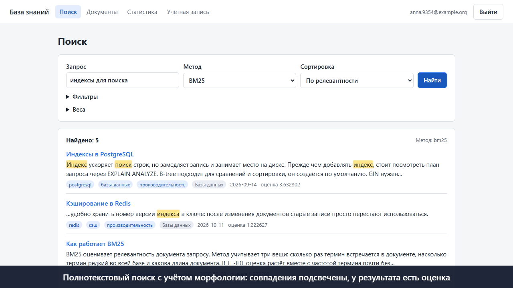

# Личная база знаний

Сервис принимает документы в формате Markdown, анализирует их, оценивает релевантность и ищет по
ним с учётом русской и английской морфологии. Проект выполняется по кейсу «Личная база знаний»
программы VK Education Projects.

## Что умеет сервис

- **Импорт и анализ.** Разбирает YAML-шапку, заголовки, код и ссылки, проверяет кодировку и размер,
  нормализует текст. Ошибка в одном файле не прерывает импорт остальных.
- **Поиск.** Морфология русского и английского языков, подсветка совпадений, фильтры по тегам, категории,
  автору и дате, сортировка, постраничная выдача.
- **Скоринг.** Методы TF-IDF, BM25, гибридный и PostgreSQL FTS. Веса полей и вклад методов задаются в
  запросе, новый метод подключается одним классом.
- **Хранение.** PostgreSQL с полной историей версий, сравнение версий и возврат к старой, защита от
  одновременной правки.
- **Кэш.** Готовая выдача хранится в Redis. Сбой Redis не останавливает сервис.
- **Пользователи.** JWT, подтверждение почты, восстановление пароля, раздельные данные, открытие документа
  другому пользователю на чтение или правку.
- **Веб-интерфейс.** Загрузка и правка документов, поиск, статистика.
- **Инфраструктура.** Docker Compose, миграции Alembic, настройка через переменные окружения, TLS на прокси.

## Демонстрация

[](docs/demo/demo.mp4)

[Видео работы сервиса](docs/demo/demo.mp4): 2 мин 50 с, без звука, пояснения идут подписями. Записано на
развёрнутом стеке скриптом `tools/demo_video.py`.

## Документация

| Документ | Что в нём |
|---|---|
| [docs/system-design.md](docs/system-design.md) | System Design: выбор стека, архитектура, API, схема БД, сценарии, нагрузка, отказы |
| [docs/architecture.md](docs/architecture.md) | Устройство сервиса и защита данных |
| [docs/scoring.md](docs/scoring.md) | Алгоритмы ранжирования и настройка весов |
| [docs/deploy.md](docs/deploy.md) | Развёртывание, импорт данных, резервное копирование |
| [docs/openapi.json](docs/openapi.json) | Контракт API, на запущенном сервисе Swagger UI по адресу `/docs` |

## Быстрый запуск в Docker

```bash
sh tools/init_env.sh
sh tools/make_cert.sh
docker compose --profile demo up -d --build
```

Сервис открывается на `https://localhost:8443`, письма со ссылками для подтверждения видны на
`http://127.0.0.1:8025`, документация методов лежит на `https://localhost:8443/docs`.

## Запуск без Docker

Нужны Python 3.10 или новее, PostgreSQL и, по желанию, Redis.

```bash
python -m venv .venv
.venv/Scripts/activate
pip install -e ".[dev]"
```

Настройки читаются из переменных окружения или файла `.env`, образец лежит в `.env.example`. Для работы
без TLS нужно указать `KB_COOKIE_SECURE=false`. Рабочий процесс должен быть один: индексы хранятся в
памяти процесса.

```bash
alembic upgrade head
uvicorn --factory kb.api.app:create_app --port 8000
```

## Примеры использования API

Методы лежат под `/api/v1`. Все методы работы с данными требуют заголовок
`Authorization: Bearer <токен>`. Ответы ниже взяты из настоящего прогона (`runs/81_readme_examples.txt`).
На Windows запускайте примеры в WSL: curl в Git Bash и cmd портит кириллицу в аргументах.

Регистрация. Письмо с разовым токеном видно на `http://127.0.0.1:8025`.

```bash
BASE=https://127.0.0.1:8443
curl -k -X POST $BASE/api/v1/auth/register -H "Content-Type: application/json" \
  -d '{"email": "reader@example.org", "password": "надёжная-фраза-для-примера", "consent": true}'
# {"message":"Если адрес можно использовать, на него отправлено письмо"}

curl -k -X POST $BASE/api/v1/auth/verify-email -H "Content-Type: application/json" \
  -d '{"token": "токен из письма"}'
```

Вход. Токен доступа из ответа передаётся в заголовке.

```bash
curl -k -X POST $BASE/api/v1/auth/login -H "Content-Type: application/json" \
  -d '{"email": "reader@example.org", "password": "надёжная-фраза-для-примера"}'
TOKEN=значение_access_token
```

Импорт файлов. В ответе перечислено, что случилось с каждым файлом.

```bash
curl -k -H "Authorization: Bearer $TOKEN" -F "files=@samples/postgresql-indexes.md" \
  -F "files=@samples/redis-cache.md" -F "files=@samples/bm25-ranking.md" \
  $BASE/api/v1/documents/import
```

```json
{
  "created": ["postgresql-indexes.md", "redis-cache.md", "bm25-ranking.md"],
  "updated": [],
  "unchanged": [],
  "failed": []
}
```

Поиск. Повторный запрос приходит из кэша, это показывает заголовок `X-Cache: HIT`.

```bash
curl -k -G -H "Authorization: Bearer $TOKEN" --data-urlencode "q=индексы" -d limit=1 \
  $BASE/api/v1/search
```

```json
{
  "total": 2,
  "scorer": "bm25",
  "sort": "relevance",
  "limit": 1,
  "offset": 0,
  "hits": [
    {
      "id": "<id>",
      "title": "Индексы в PostgreSQL",
      "score": 0.912977,
      "snippet": "<mark>Индекс</mark> ускоряет поиск строк, но замедляет запись и занимает место на диске...",
      "tags": ["postgresql", "базы-данных", "производительность"],
      "category": "Базы данных",
      "created": "2026-09-14"
    }
  ]
}
```

Гибридный метод со своими весами и фильтр по тегу.

```bash
curl -k -G -H "Authorization: Bearer $TOKEN" --data-urlencode "q=кэш" -d scorer=hybrid \
  -d w_title=10 -d hybrid_bm25=0.5 -d hybrid_tfidf=0.5 --data-urlencode "tags=redis" \
  $BASE/api/v1/search
```

Новая версия документа. Поле `expected_version` защищает от одновременной правки: если документ уже
изменили, сервис отвечает кодом 409.

```bash
curl -k -X PUT -H "Authorization: Bearer $TOKEN" -H "Content-Type: application/json" \
  -d '{"content": "# Заголовок\n\nНовый текст.\n", "expected_version": 1}' \
  $BASE/api/v1/documents/$DOC
```

```json
{"error": {"code": "version_conflict", "message": "Ожидалась версия 1, текущая 2"}}
```

История версий лежит в `GET /documents/{id}/versions`, сравнение в `GET /documents/{id}/diff`, статистика
базы в `GET /stats`, состояние служб в `GET /health`.

```json
{"status": "ok", "database": "ok", "cache": "ok"}
```

## Командная строка

Командная строка работает с каталогом файлов и не требует ни базы данных, ни Redis.

```bash
kb check samples
kb stats samples
kb search samples "индексы для поиска"
kb search samples "кэш" --scorer tfidf --tag производительность --sort created --limit 5
kb -v search samples "кэш"
```

Шапка документа необязательна. Без неё название берётся из первого заголовка или имени файла.

```markdown
---
title: Индексы в PostgreSQL
tags: [postgresql, производительность]
category: Базы данных
author: Автор
created: 2026-09-14
---
```

## Методы скоринга

| Имя | Метод |
|---|---|
| `bm25` | Okapi BM25 с параметрами `k1` и `b` |
| `tfidf` | TF-IDF с логарифмической частотой и нормализацией на длину |
| `hybrid` | Взвешенная сумма нормализованных оценок других методов |
| `pgfts` | Полнотекстовый поиск PostgreSQL с индексом GIN |

Формулы и настройка весов описаны в [docs/scoring.md](docs/scoring.md). Совпадения в полях весят
по-разному: название 3, подзаголовки 2, теги 2, текст 1, код 0,5. Веса
задаются параметром `field_weights`. Новый метод подключается так:

```python
from kb.scoring import Scorer, register_scorer


@register_scorer
class MyScorer(Scorer):
    name = "my-method"

    def score(self, query_terms, index): ...
```

## Структура

| Модуль | Назначение |
|---|---|
| `kb/normalize.py` | Проверка и нормализация текста и метаданных |
| `kb/parser.py` | Разбор Markdown и YAML-шапки |
| `kb/analysis.py` | Показатели документа, оглавление и замечания |
| `kb/textproc.py` | Токенизация, стоп-слова и стемминг |
| `kb/index.py` | Обратный индекс |
| `kb/scoring.py` | Методы скоринга и их реестр |
| `kb/highlight.py` | Фрагменты выдачи с подсветкой |
| `kb/search.py` | Поиск, фильтры, сортировка и постраничная выдача |
| `kb/importer.py` | Импорт каталога |
| `kb/cli.py` | Командная строка |
| `kb/config.py` | Настройки из окружения |
| `kb/storage/` | Таблицы и репозиторий документов с версиями |
| `kb/cache.py` | Кэш выдачи: Redis, память, пустой кэш |
| `kb/service.py` | Сервис: согласует хранилище, индексы пользователей и кэш, проверяет доступ |
| `kb/security.py` | Хэши паролей, токены доступа и разовые токены |
| `kb/auth.py` | Регистрация, вход, восстановление пароля |
| `kb/ratelimit.py` | Ограничение числа попыток |
| `kb/mailer.py` | Отправка писем |
| `kb/api/` | REST API: методы, схемы, обработка ошибок, журнал запросов |
| `kb/web/` | Веб-интерфейс без сборки: страница, скрипт и стили |

## Проверка

```bash
pytest --cov=kb --cov-report=term-missing
ruff check src tests tools
mypy
python tools/bench.py --docs 2000
python tools/bench_service.py
python tools/bench_scale.py
python tools/ui_smoke.py
python tools/api_smoke.py
python tools/security_smoke.py
python tools/ops_smoke.py
python tools/bench_load.py
python tools/demo_video.py
```

Тесты на настоящих PostgreSQL и Redis включаются переменными `KB_TEST_DATABASE_URL` и
`KB_TEST_REDIS_URL`, без них они пропускаются. Схемы пересобираются командами
`python tools/diagrams.py` и `python tools/diagrams_service.py`.

В каталоге `runs/` лежит вывод реальных прогонов тестов, линтера, отладчика и замеров. Замеры
выполнены на синтетическом корпусе из `tools/bench.py`: словарь в нём меньше, чем в настоящих
текстах, поэтому выигрыш от кэша стемминга на реальных документах будет ниже.
