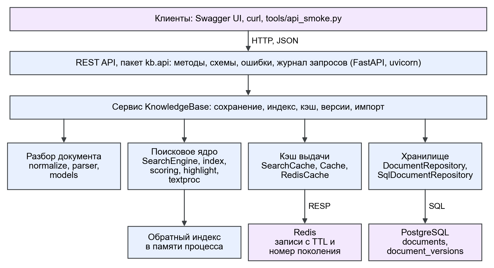
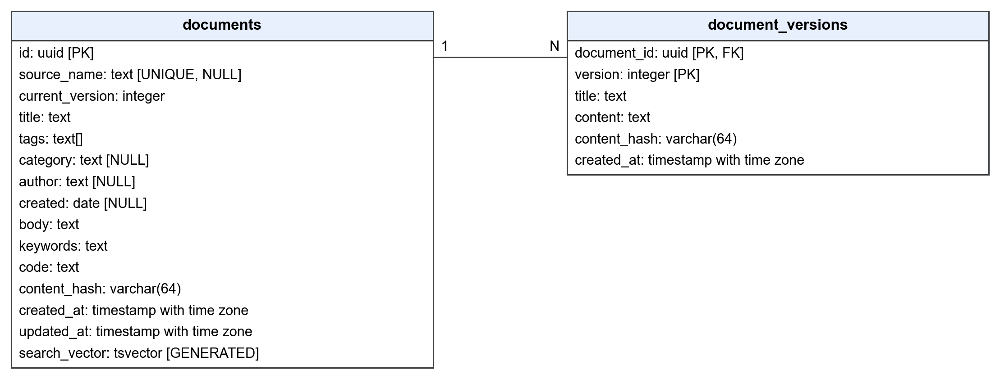
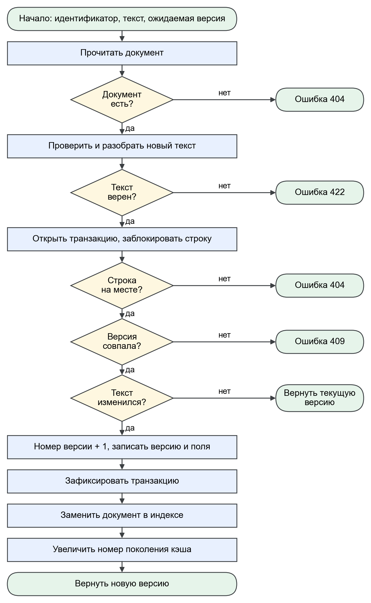
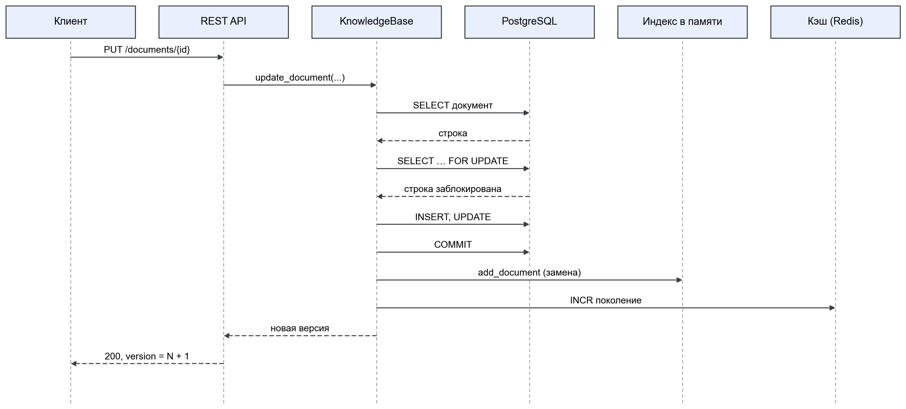
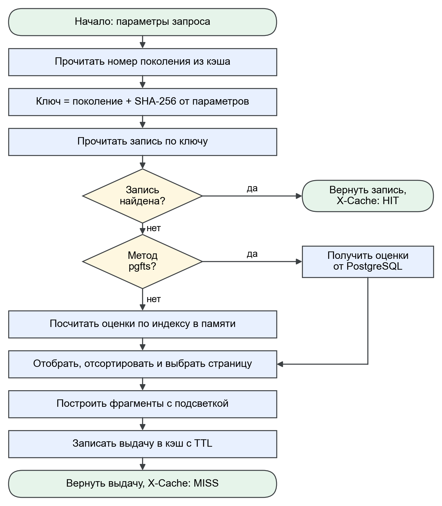
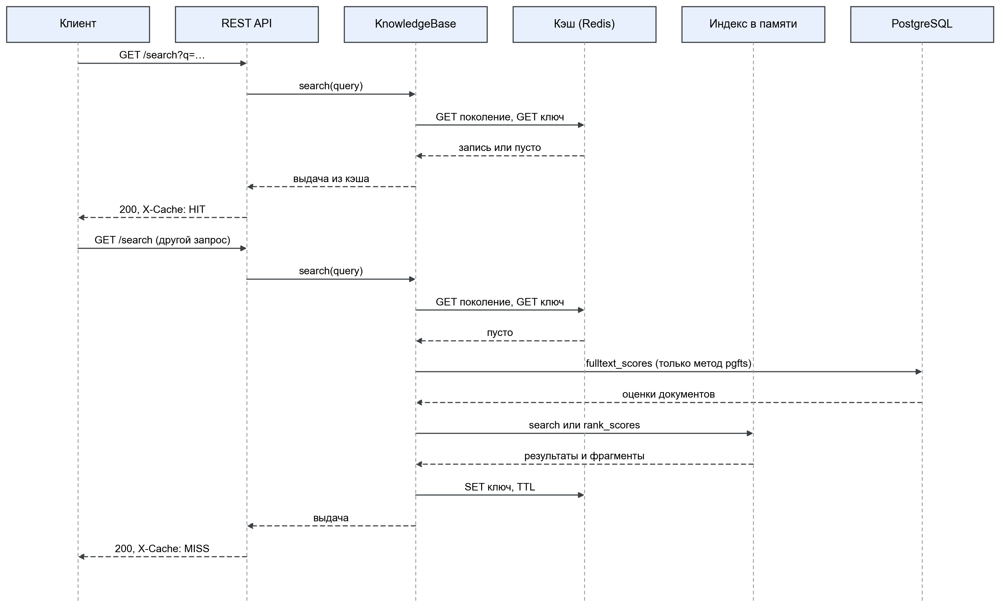
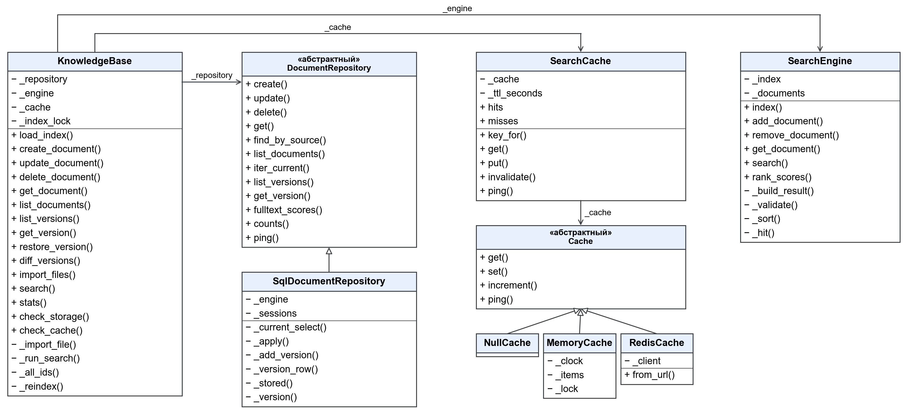
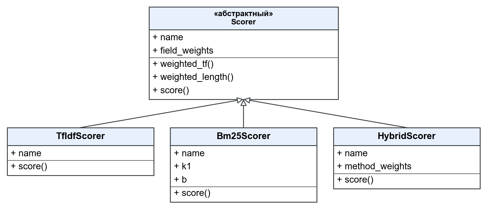

# Устройство сервиса

## Назначение

Сервис хранит заметки в формате Markdown, ведёт историю их версий и ищет по ним с учётом русской и
английской морфологии. Пользователь один, авторизации на этом этапе нет.

## Компоненты

| Компонент | Что делает | Где данные |
|---|---|---|
| `kb.api` | Принимает запросы HTTP, проверяет параметры, переводит ошибки в единый формат | нет |
| `KnowledgeBase` | Согласует хранилище, индекс и кэш, ведёт импорт и версии | нет |
| `SearchEngine` | Индексирует документы, считает оценки, сортирует, строит фрагменты | память процесса |
| `SearchCache` | Хранит готовую выдачу, сбрасывается при изменении документов | Redis |
| `SqlDocumentRepository` | Хранит документы и все их версии | PostgreSQL |

## Хранение

`documents` содержит текущее состояние документа, `document_versions` содержит полный текст каждой
версии. Новая версия появляется только при изменении SHA-256 от нормализованного текста, поэтому
смена переводов строк её не создаёт. Удаление документа удаляет и его версии каскадом.

Схема меняется только миграциями Alembic. Соответствие миграций и моделей проверяет тест
`test_models_match_migrations`.

## Порядок записи

1. Документ проверяется и разбирается до открытия транзакции.
2. В транзакции строка блокируется через `SELECT ... FOR UPDATE` и сверяется ожидаемая версия.
   Несовпадение даёт ответ 409.
3. После фиксации обновляется индекс и увеличивается номер поколения кэша.

Если процесс упадёт между шагами 2 и 3, данные не потеряются: при запуске индекс строится заново из
базы, а кэш сбрасывается.

## Поиск и кэш

Ключ записи имеет вид `kb:search:{поколение}:{sha256(параметры запроса)}`. Изменение документа
увеличивает номер поколения, поэтому старые записи перестают читаться и удаляются сами по истечении
TTL (300 с). Параметры запроса приводятся к каноническому JSON с упорядоченными именами полей.

Сбой Redis не останавливает сервис: операция записывает предупреждение в журнал и ведёт себя как
обращение к пустому кэшу, таймаут 0,25 с.

Метод `pgfts` получает оценки от полнотекстового поиска PostgreSQL. Остальные методы (`bm25`,
`tfidf`, `hybrid`) считают их по индексу в памяти. Фильтры, сортировка и страницы у всех методов
общие.

## Ограничения

- Индекс живёт в памяти процесса, поэтому рабочий процесс uvicorn должен быть один. Чтобы запустить
  несколько, индекс нужно вынести или синхронизировать между процессами.
- Если Redis недоступен именно в момент сброса, номер поколения не увеличится и записи в кэше могут
  отдавать старую выдачу до истечения TTL.
- Индекс GIN используется только для редких слов. На частых словах планировщик выбирает
  последовательное чтение, так как подходит большая часть строк (`runs/46_bench_service.txt`).
- На Windows адрес `localhost` сначала пробует IPv6 и теряет около 2 с, в настройках нужно указывать
  `127.0.0.1` (`runs/34_connect_timing.txt`).

## Классы

Схемы классов и таблиц строит `tools/diagrams_service.py` разбором исходного кода и метаданных
SQLAlchemy, поэтому они соответствуют текущей версии.
