# System Design: личная база знаний

Документ объясняет, какие решения приняты в сервисе и почему. Подробности лежат рядом:
[устройство сервиса и защита данных](architecture.md), [алгоритмы ранжирования](scoring.md),
[развёртывание и импорт](deploy.md), [контракт API](openapi.json).

## 1. Задача

Сервис принимает заметки в формате Markdown, анализирует их, оценивает релевантность и ищет по ним с
учётом русской и английской морфологии. Рассчитан на личную базу или небольшую группу: у каждого
пользователя свои документы, документом можно поделиться.

| Раздел ТЗ | Как реализовано | Где в коде |
|---|---|---|
| Импорт, анализ, валидация и нормализация | YAML-шапка, заголовки, код, ссылки; NFC, переводы строк, проверка размера и кодировки | `normalize`, `parser`, `analysis`, `importer` |
| Скоринг и индексация | Обратный индекс, TF-IDF и BM25 с весами полей | `index`, `scoring`, `textproc` |
| Поиск | Морфология, фильтры, сортировка, страницы, подсветка | `search`, `highlight` |
| Хранение и кэш | PostgreSQL с полной историей версий, кэш выдачи в Redis | `storage`, `cache` |
| Несколько методов, гибрид, веса | `bm25`, `tfidf`, `hybrid`, `pgfts`; веса полей и методов задаются в запросе | `scoring`, `api/routes` |
| Аутентификация и доступ | JWT, раздельные индексы пользователей, права на чтение и правку | `security`, `auth`, `service` |
| Веб-приложение | Загрузка и правка документов, поиск с фильтрами, статистика | `web` |

Elasticsearch в проекте нет: ТЗ допускает встроенные средства, причина описана в разделе 2.

Требования к качеству, которые определили архитектуру:

- сбой кэша не должен останавливать работу, а сбой базы не должен портить данные;
- чужие документы нельзя ни прочитать, ни обнаружить;
- одновременная правка не должна молча терять изменения;
- весь стек поднимается через Docker Compose на обычном компьютере.

## 2. Выбор стека

Версии взяты из образа, полный список лежит в `constraints.txt`.

| Задача | Выбрано | Почему | Что учтено при выборе |
|---|---|---|---|
| Язык | Python 3.13 | Готовые стеммер Snowball и разбор Markdown, быстрая разработка, простые тесты | Один процесс занимает одно ядро: это и есть предел нагрузки (раздел 8) |
| API | FastAPI 0.162, pydantic 2.14, uvicorn 0.54 | Проверка параметров по типам и контракт OpenAPI без ручной работы | Swagger UI получается сам |
| Поиск | Собственный индекс в памяти и PostgreSQL FTS | ТЗ просит реализовать методы и настройку весов, поэтому оценки считает наш код. FTS даёт второй способ поиска и сравнение с ним | Elasticsearch дал бы масштабирование, но это отдельная служба на JVM, избыточная для личной базы. При росте нагрузки это первый кандидат (раздел 10) |
| База данных | PostgreSQL 18, SQLAlchemy 2.1, Alembic 1.20 | Транзакции и блокировки строк для версий, встроенный полнотекстовый поиск, массивы для тегов | MongoDB не подходит: версии и права связаны между собой, транзакции здесь важнее гибкой схемы |
| Кэш | Redis 8 | Записи с TTL и атомарные счётчики для поколений кэша и лимитов | Memcached подошёл бы для выдачи, но счётчики попыток удобнее держать в той же службе |
| Парсер | markdown-it-py, PyYAML | Токены вместо регулярных выражений: код и заголовки разбираются надёжно | |
| Пароли и токены | Argon2id, PyJWT (HS256) | Argon2id устойчив к перебору на видеокартах, алгоритм подписи задан жёстко | Токен сверяется с версией в базе, поэтому его можно отозвать |
| Веб-интерфейс | Страница без сборки: HTML, CSS, JavaScript | Нет зависимостей и шага сборки, работает строгая политика CSP | Фреймворк не окупился бы на интерфейсе такого размера |
| Прокси | nginx 1.29 | TLS, заголовки безопасности, сжатие, ограничение частоты | |
| Контейнеры | Docker, Compose | Один файл описывает весь стек и порядок запуска | Запуск проверен в Docker внутри WSL 2 |

## 3. Архитектура

Сервис построен слоями: каждый слой знает только о нижнем, а хранилища скрыты за абстрактными
классами. Ядро работает и без сервера: командная строка `kb` ищет по каталогу файлов без базы и Redis.

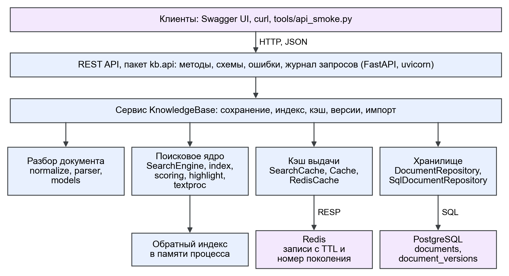

Зависимости модулей ядра:

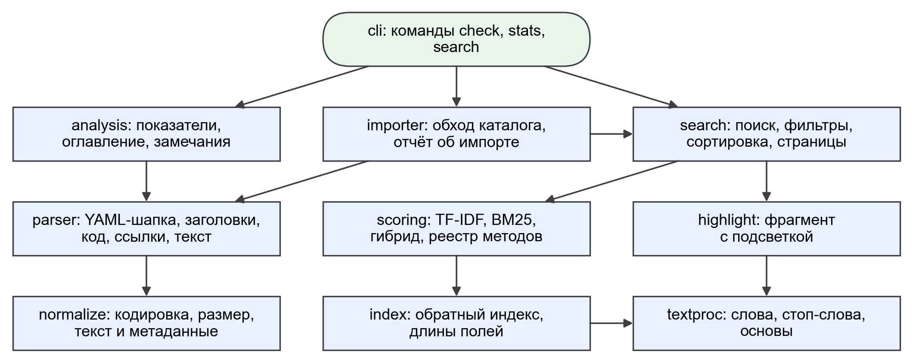

Места расширения: новый метод скоринга подключается декоратором `@register_scorer`, хранилище и кэш
заменяются через `DocumentRepository` и `Cache`, отправка писем через `Mailer`. Роли классов описаны в
[architecture.md](architecture.md#компоненты), диаграмма классов там же.

### Развёртывание

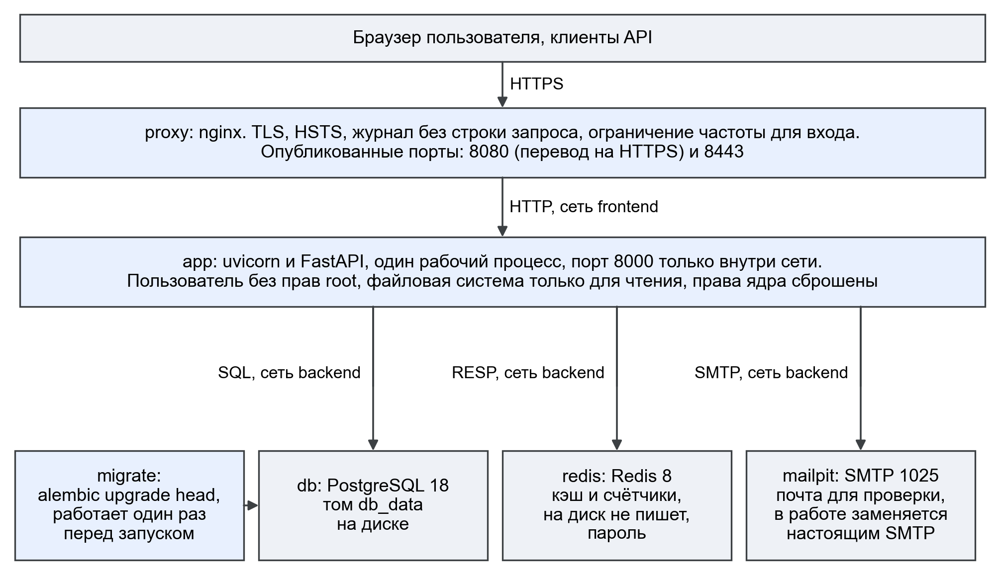

| Служба | Образ | Назначение | Наружу |
|---|---|---|---|
| `proxy` | nginx:1.29-alpine | TLS, перенаправление на HTTPS, ограничение частоты | 8080, 8443 |
| `app` | knowledge-base:0.2.0 | API и веб-интерфейс, один рабочий процесс | нет |
| `migrate` | knowledge-base:0.2.0 | Применяет миграции и завершается до запуска `app` | нет |
| `db` | postgres:18 | Документы, версии, пользователи, доступ | нет |
| `redis` | redis:8 | Кэш и счётчики, без записи на диск, предел 128 МБ | нет |
| `mailpit` | axllent/mailpit:v1.27 | Почта для демонстрации, профиль `demo` | только 127.0.0.1:8025 |

База и Redis находятся во внутренней сети `backend`, у которой нет выхода наружу. Контейнеры `app` и
`migrate` работают от обычного пользователя, с файловой системой только для чтения и без лишних
возможностей ядра.

## 4. API

Контракт лежит в [openapi.json](openapi.json), на запущенном сервисе его показывает Swagger UI по
адресу `/docs`. Всего 27 методов на 23 путях под префиксом `/api/v1`.

| Группа | Методы |
|---|---|
| Аутентификация | `POST /auth/register`, `/auth/verify-email`, `/auth/login`, `/auth/refresh`, `/auth/logout`, `/auth/password/change`, `/auth/password/forgot`, `/auth/password/reset`, `/auth/me/delete`; `GET /auth/me` |
| Документы | `POST /documents`, `POST /documents/import`, `GET /documents`, `GET`, `PUT`, `DELETE /documents/{doc_id}`, `GET /documents/{doc_id}/preview` |
| Версии | `GET /documents/{doc_id}/versions`, `GET .../versions/{version}`, `POST .../versions/{version}/restore`, `GET .../diff` |
| Доступ | `GET`, `PUT /documents/{doc_id}/shares`, `DELETE .../shares/{user_id}` |
| Поиск | `GET /search` |
| Служебные | `GET /health`, `GET /stats` |

Решения, общие для всех методов:

- **Доступ.** Запросы к данным идут с заголовком `Authorization: Bearer <токен>`. Токен обновления лежит
  в cookie с флагами HttpOnly, Secure и SameSite=Strict.
- **Ошибки.** Единый формат `{"error": {"code": "...", "message": "..."}}`, код не зависит от языка
  сообщения.
- **Коды ответа.** 401 — нет токена, 403 — не хватает прав на открытый документ, 404 — документа нет или
  он чужой, 409 — конфликт версий, 422 — неверные данные, 429 — превышен лимит, 503 — база недоступна.
- **Одновременная правка.** `PUT` принимает `expected_version`, при расхождении ответ 409.

Параметры поиска: `q`, `scorer`, `tags`, `category`, `author`, `created_from`, `created_to`, `sort`,
`limit`, `offset`, веса полей `w_title`, `w_headings`, `w_tags`, `w_body`, `w_code` и веса гибридного
метода `hybrid_bm25`, `hybrid_tfidf`.

## 5. Схема базы данных

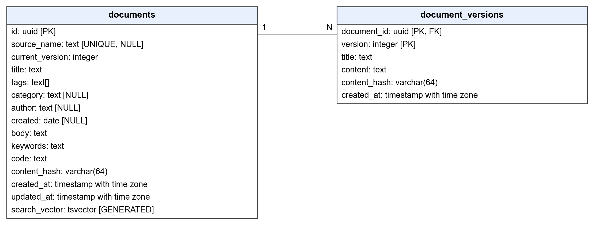

| Таблица | Что хранит | Ключи и индексы |
|---|---|---|
| `users` | Адрес, хэш пароля, версия токенов, дата согласия | Уникальный `email` |
| `auth_tokens` | Хэши разовых токенов подтверждения и восстановления | Ключ `token_hash`, индекс `user_id` |
| `documents` | Текущее состояние документа, метаданные, поисковый вектор | GIN по `search_vector` и `tags`, индексы `updated_at` и `owner_id`, уникальная пара `owner_id`, `source_name` |
| `document_versions` | Полный текст каждой версии | Ключ `document_id`, `version` |
| `document_shares` | Кому и с какими правами открыт документ | Ключ `document_id`, `user_id`, индекс `user_id`, проверка `permission IN ('read', 'write')` |

Решения по схеме:

- Текущее состояние отделено от истории: чтение и поиск не трогают таблицу версий.
- Поле `search_vector` вычисляет сама база, поэтому оно не может разойтись с текстом. Каждому полю назначен
  свой вес: A для названия, B для подзаголовков и тегов, C для текста, D для кода.
- Новая версия появляется только при изменении SHA-256 от нормализованного текста.
- Внешние ключи удаляются каскадом: удаление учётной записи убирает документы, версии и доступы.
- Схема меняется только четырьмя миграциями Alembic, совпадение с моделями проверяет тест
  `test_models_match_migrations`.

## 6. Основные сценарии

**Импорт.** Ошибка в одном файле попадает в отчёт и не прерывает остальные. Файлы с тем же именем
обновляются, при неизменённом тексте версия не создаётся.

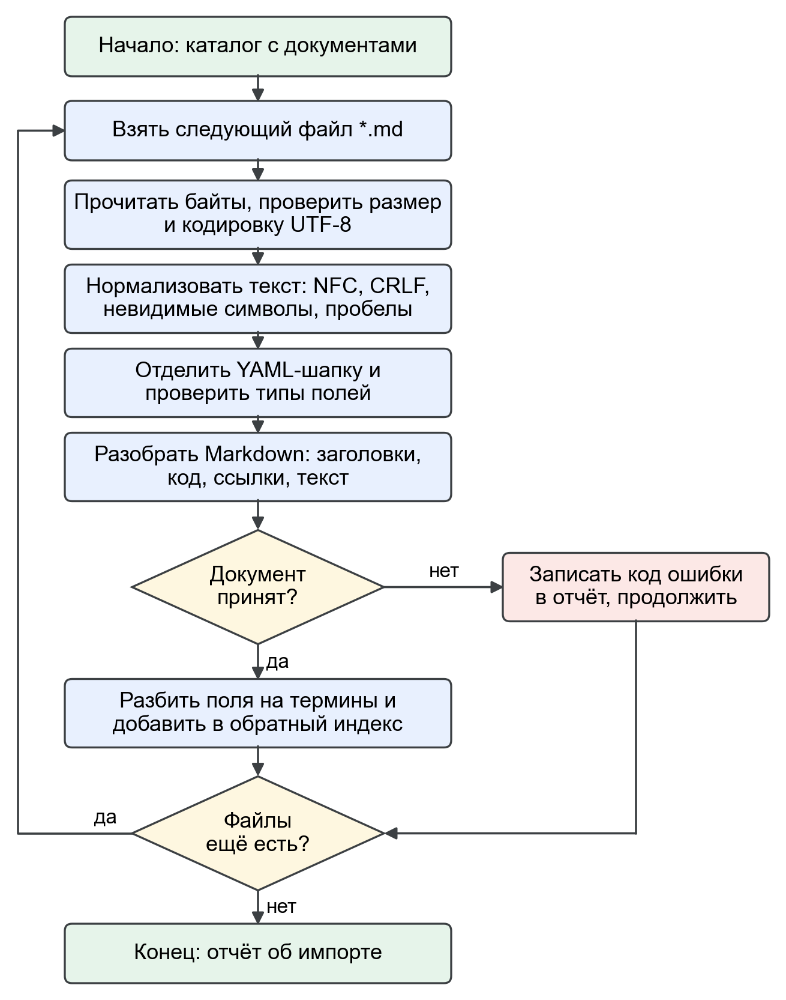

**Сохранение.** Документ проверяется до открытия транзакции, строка блокируется через
`SELECT ... FOR UPDATE`. Индекс и кэш меняются только после фиксации. Если процесс упадёт между этими
шагами, индекс построится заново из базы при запуске.

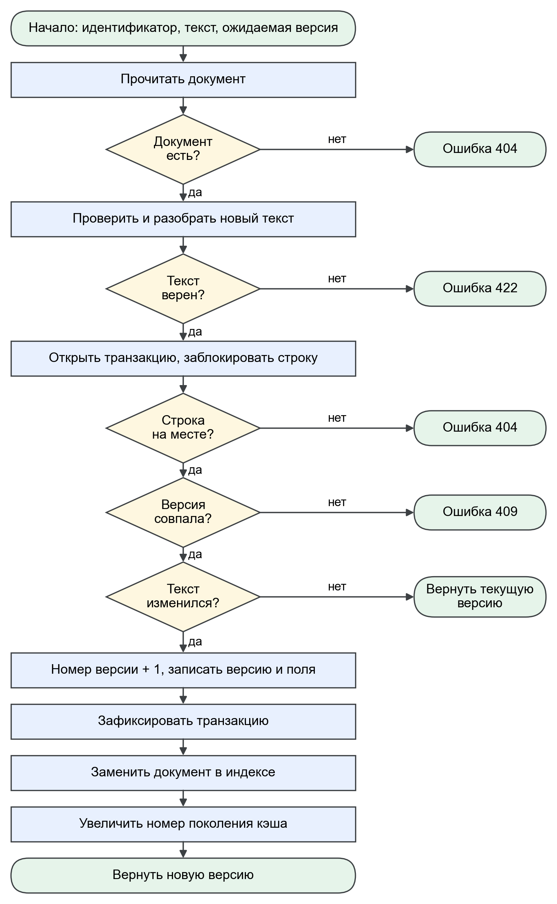

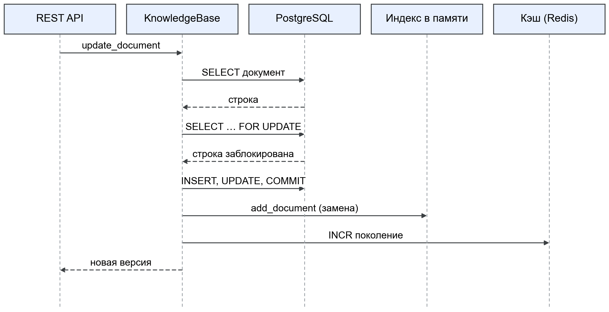

**Поиск.** Выдача сначала ищется в кэше. При промахе метод считает оценки по индексу в памяти либо
получает их от PostgreSQL. Фильтры, сортировка, страницы и подсветка у всех методов общие.

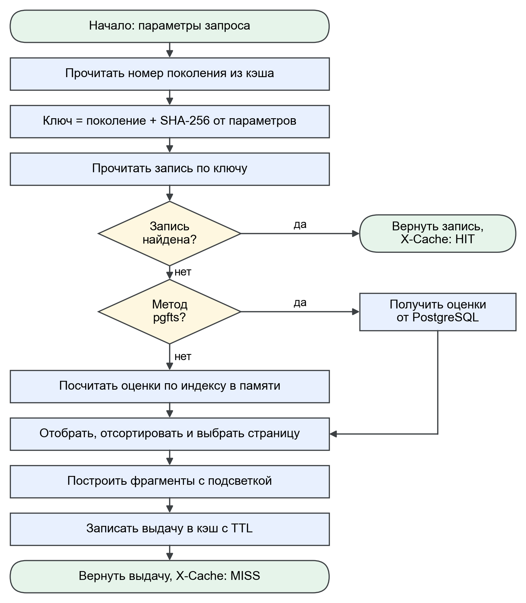

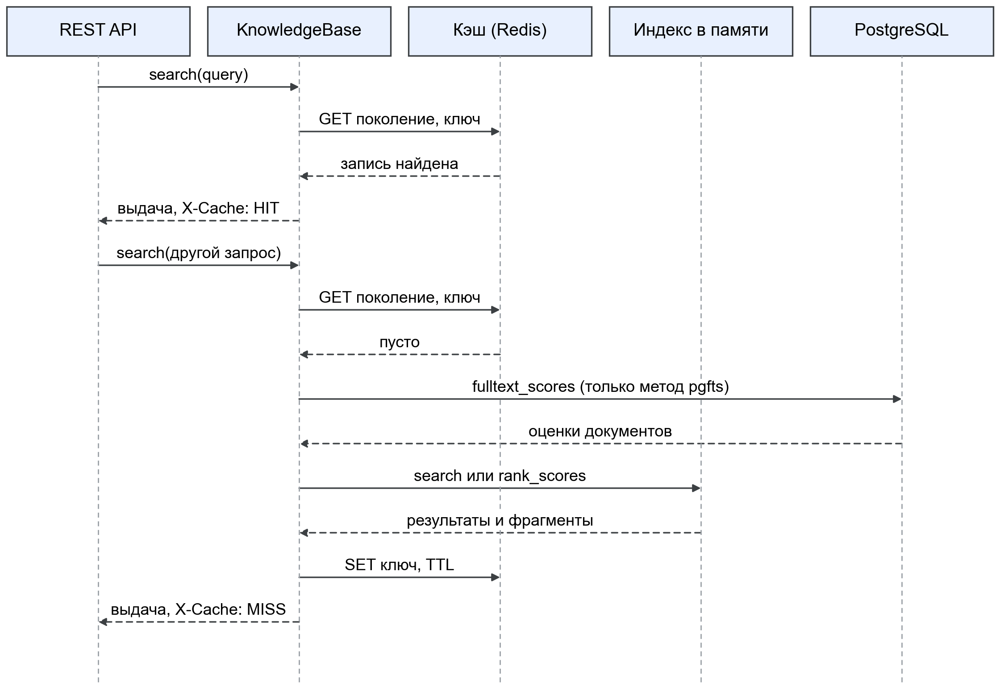

**Вход и восстановление пароля.** Ответы одинаковы для занятого и свободного адреса, поэтому по ним
нельзя перебрать адреса пользователей.

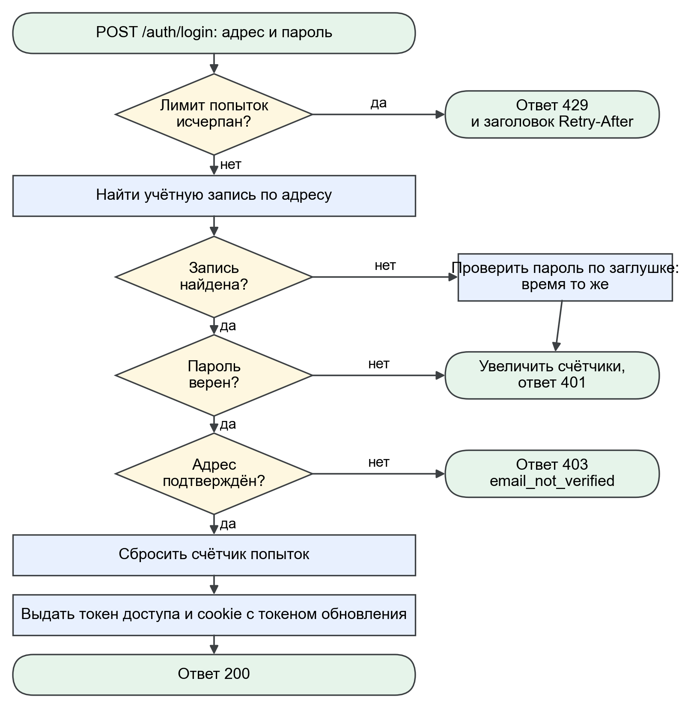

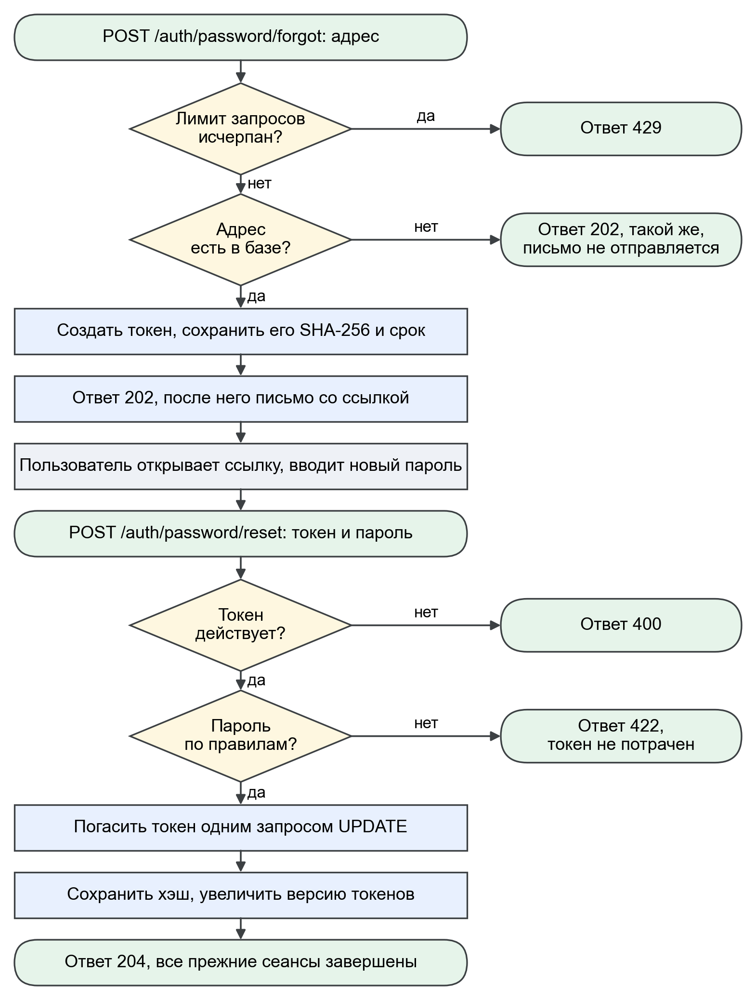

**Проверка прав.** Для пользователя без доступа ответ 404: документа для него как будто нет.

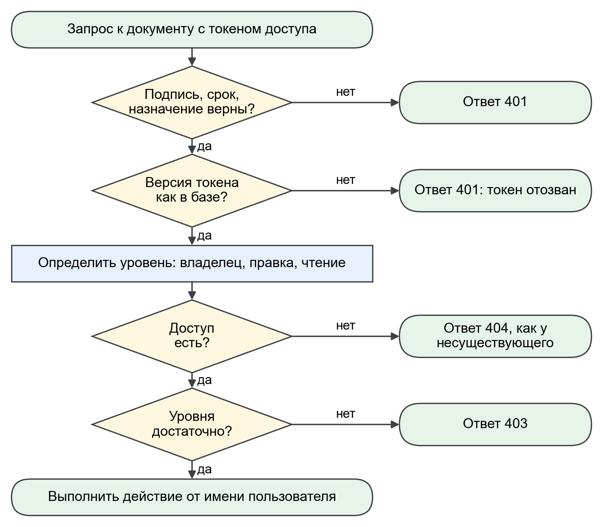

## 7. Кэш

В Redis хранится готовая выдача, срок жизни записи 300 с. Ключ содержит номера поколений:
`kb:search:{общее поколение}:{пользователь}:{поколение пользователя}:{sha256 параметров}`. Изменение
документа увеличивает номер поколения у всех, кому он доступен, поэтому старые записи перестают читаться
и удаляются сами. Изменения одного пользователя не сбрасывают кэш других.

## 8. Нагрузка и ресурсы

Стенд: Intel Core i5-14400F, Docker внутри WSL 2, корпус из 2000 синтетических документов общим объёмом
15,5 МБ, клиент работает в Windows и идёт через мост WSL и TLS (`runs/69_bench_load.txt`).

| Режим | Лучшая пропускная способность | p95 при 16 клиентах |
|---|---|---|
| `bm25`, новые запросы | 106 запросов в секунду | 212 мс |
| `pgfts`, новые запросы | 97 запросов в секунду | 267 мс |
| `bm25`, повторные запросы из кэша | 215 запросов в секунду | 90 мс |
| Загрузка документов | 113,5 документа в секунду | |

Ограничение упирается в одно ядро процесса сервиса: индекс лежит в его памяти, и рабочий процесс один.
Сохранение версии занимает около 10 мс внутри сети Docker (`runs/76_write_latency.txt`).

Рост от 250 до 8000 документов близок к линейному, замеры лежат в `runs/62_bench_scale.txt`. Память
сервиса растёт примерно на 105 МБ на 1000 документов. Минимальная конфигурация из
`compose.limits.yaml` (2 ядра, 920 МБ на службы) выдержала 2000 документов и 16 клиентов: 70 запросов в
секунду без ошибок (`runs/78_bench_limits.txt`). Рекомендуемая конфигурация в
[deploy.md](deploy.md#требования-к-ресурсам) рассчитана, но не проверялась.

## 9. Отказы

Поведение проверяет `tools/ops_smoke.py` на запущенном стеке: 16 проверок, 0 ошибок
(`runs/72_ops_smoke.txt`).

| Что случилось | Как ведёт себя сервис |
|---|---|
| Перезапуск `app` | Снова отвечает через 6,2 с, индекс восстановлен из базы, токены действуют |
| Остановлен Redis | `/health` отвечает 200 со статусом `degraded`, поиск и сохранение работают без кэша. Таймаут обращения 0,25 с |
| Остановлен PostgreSQL | Ответ 503 с кодом `database_unavailable` и без трассировки. После запуска базы всё читается |
| Контейнеры пересозданы | Данные остаются в томе `db_data` |
| Падение между фиксацией и обновлением индекса | Данные в базе целы, индекс строится заново при запуске |

Резервное копирование описано в [deploy.md](deploy.md#резервное-копирование).

## 10. Качество и ограничения

| Проверка | Результат | Прогон |
|---|---|---|
| Unit и интеграционные тесты на настоящих PostgreSQL и Redis, в контейнере | 569 пройдено, покрытие 99 % | `runs/74_tests_in_container.txt` |
| Сценарий в браузере на развёрнутом сервисе | 26 шагов, 0 ошибок | `runs/63_ui_smoke.txt` |
| Проверка защиты через API | 52 проверки, 0 ошибок | `runs/67_security_smoke.txt` |
| Поведение при сбоях | 16 проверок, 0 ошибок | `runs/72_ops_smoke.txt` |

Известные ограничения и что делать при росте:

- Индекс живёт в памяти одного процесса, поэтому поиск упирается в одно ядро. Для нескольких процессов
  индекс нужно вынести: перейти на `pgfts` или подключить OpenSearch через новый класс скоринга.
- Индекс документа хранится у каждого, кому документ доступен, поэтому открытый многим документ занимает
  больше памяти.
- Если Redis недоступен в момент сброса, старая выдача может читаться до истечения TTL.
- Данные на диске не шифруются, включая резервные копии: это задача шифрования диска на сервере.
- Выход завершает сеанс на всех устройствах, отдельных сеансов нет.
- Сертификат стенда самоподписанный, в открытой сети его нужно заменить ([deploy.md](deploy.md#работа-в-открытой-сети)).
